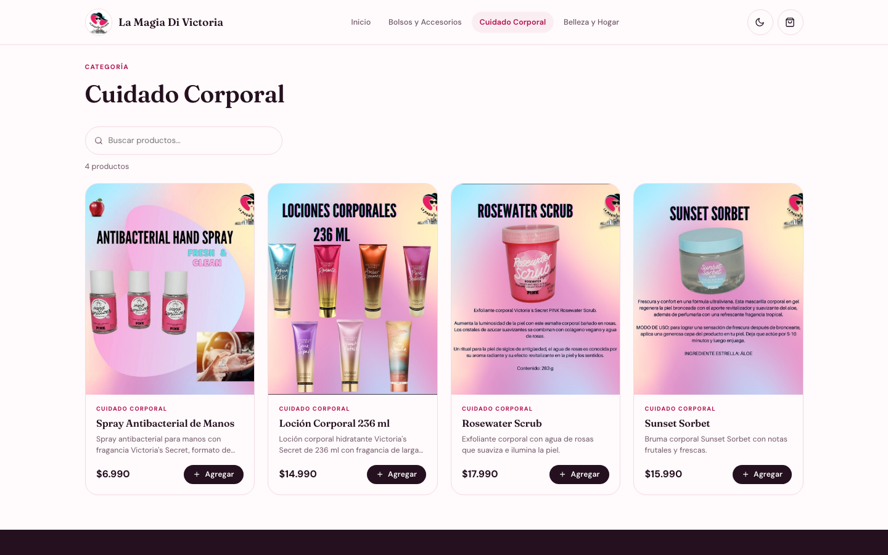
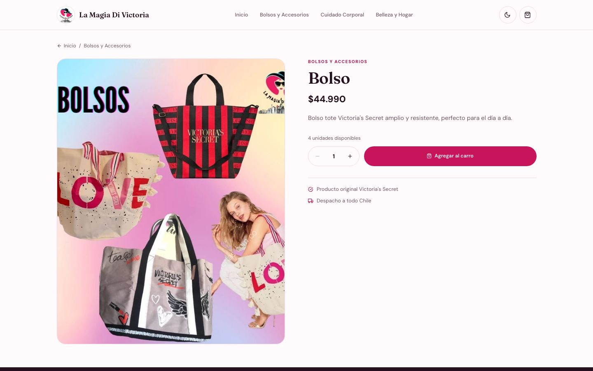
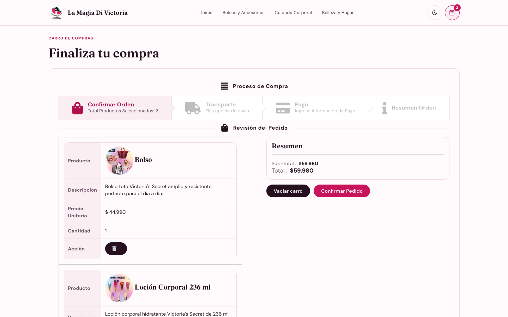
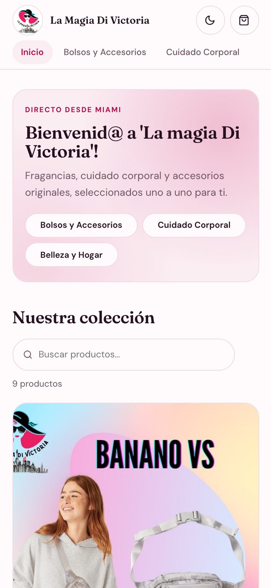

# La Magia di Victoria 🛍️

Tienda online para **La Magia di Victoria**, una pyme chilena que vende productos Victoria's Secret traídos directamente desde Miami: bolsos y accesorios, cuidado corporal y belleza.

Nació como proyecto final del curso de ReactJS de [Coderhouse] y luego se rediseñó por completo.


## Funcionalidades

- Catálogo con filtro por categoría y búsqueda por nombre.
- Página de detalle de cada producto, con selector de cantidad que respeta el stock.
- Carro de compras global, con contador en la barra superior.
- Checkout en 4 pasos: revisión del pedido → datos de despacho → pago → resumen de la orden con su código.
- Formularios validados con Formik + Yup.
- Modo claro y oscuro.
- Diseño responsive para celular, tablet y escritorio.

## Capturas

| Categoría | Detalle de producto |
| --- | --- |
|  |  |

| Carro y checkout | Modo oscuro |
| --- | --- |
|  |  |

<p align="center">
  
</p>

## Tecnologías

- [React 17](https://react.dev/) con Create React App
- [React Router 6](https://reactrouter.com/) para la navegación
- [Semantic UI React](https://react.semantic-ui.com/) en el checkout
- [Formik](https://formik.org/) y [Yup](https://github.com/jquense/yup) para formularios y validaciones
- [SweetAlert2](https://sweetalert2.github.io/) para avisos
- [React Icons](https://react-icons.github.io/react-icons/)

## Cómo correrlo

Requiere Node 24.

```bash
npm install
npm start          # http://localhost:3000
npm run build      # build de producción en /build
```

Los scripts `start` y `build` incluyen `NODE_OPTIONS=--openssl-legacy-provider`, que es necesario para que react-scripts 4 funcione con Node 17 o superior.

### Datos

Los productos vienen de una API simulada en [`src/mock/api.js`](src/mock/api.js), así que la app funciona sin backend. Las órdenes de compra se guardan en el `localStorage` del navegador.

La versión original usaba Firebase Firestore. La configuración sigue en `src/firebase/` por si se quiere volver a conectar.

### Variables de entorno

El archivo `.env` define los textos de la tienda y los links a redes sociales:

| Variable | Uso |
| --- | --- |
| `REACT_APP_NAME_BUSINESS` | Nombre de la tienda en la barra superior y el pie de página |
| `REACT_APP_GREETING` | Título de bienvenida en la portada |
| `REACT_APP_RESUMEN_ORDER_THANKS` | Mensaje de agradecimiento al terminar la compra |
| `REACT_APP_INSTAGRAM`, `REACT_APP_FACEBOOK` | Links a redes sociales |

## Estructura

```
src/
├── components/   Header, Footer, catálogo (Item*), carro y checkout (Cart/*)
├── context/      CartContext: carro, paso del checkout y orden de compra
├── mock/         API simulada con los productos y las órdenes
├── views/        Páginas: inicio, categoría, carro, 404
└── utils/        Formato de precios, avisos, modo oscuro, scroll al cambiar de página
```

## Autor

**Rodrigo Raggi Palma** 🧑‍💻

- [LinkedIn](https://www.linkedin.com/in/rodrigo-palma-raggi-67537158)
- [Instagram](https://www.instagram.com/hrodrico)

Tienda: [@la_magia_di_victoria](https://www.instagram.com/la_magia_di_victoria/)

---

Si te gustó el proyecto, deja una ⭐

[Coderhouse]: https://www.coderhouse.com/
